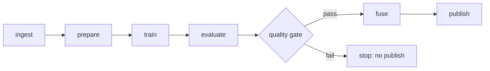

# mlx-finetune-pipeline

Fine-tune **LLMs, NLP (embedding) models, and vision-language models** locally on
Apple Silicon with [MLX](https://github.com/ml-explore/mlx), orchestrated as a
[ZenML](https://zenml.io) pipeline with [MLflow](https://mlflow.org) experiment
tracking, ending in a push to the Hugging Face Hub.

Everything is open source and runs on a single Mac (built on a Mac Studio).

## Architecture

Training **must run natively on macOS** — MLX needs Metal (the Apple GPU), which
Docker containers cannot access. So the design is split in two:

```
┌─────────────────────────── Mac Studio (host) ────────────────────────────┐
│                                                                          │
│   Pipeline (native Python + MLX, uses the Metal GPU)                     │
│                                                                          │
│   ┌────────┐  ┌─────────┐  ┌───────┐  ┌──────────┐  ┌──────┐  ┌───────┐  │
│   │ ingest │→ │ prepare │→ │ train │→ │ evaluate │→ │ fuse │→ │publish│  │
│   └────────┘  └─────────┘  └───────┘  └──────────┘  └──────┘  └───┬───┘  │
│        │            │           │            │                    │      │
│        └────────────┴─────┬─────┴────────────┘                    │      │
│                           │ metrics, params, artifacts            │      │
│  ┌────────────────────────▼──────────────────────────┐            │      │
│  │              Docker Compose stack                 │            │      │
│  │  ┌──────────────────┐   ┌──────────────────────┐  │            │      │
│  │  │  MLflow server   │   │    ZenML server      │  │            │      │
│  │  │  localhost:5001  │   │    localhost:8080    │  │            │      │
│  │  │  (tracking, UI)  │   │  (pipeline runs, UI) │  │            │      │
│  │  └──────────────────┘   └──────────────────────┘  │            │      │
│  └───────────────────────────────────────────────────┘            │      │
│                                                                   │      │
└───────────────────────────────────────────────────────────────────┼──────┘
                                                                    ▼
                                                          🤗 Hugging Face Hub
```

## Pipeline nodes

Each node is a ZenML step with exactly one responsibility, and each is
independently unit-tested:



| Node | Responsibility |
|---|---|
| `ingest` | Load the raw dataset (local files or HF datasets) and validate its schema. |
| `prepare` | Convert to the format the trainer expects (chat template / image-text pairs), split train/valid/test. |
| `train` | Run MLX fine-tuning (LoRA / QLoRA / DoRA / full) via `mlx-lm` (LLM/NLP) or `mlx-vlm` (vision). Logs to MLflow. |
| `evaluate` | Score the tuned adapter on the held-out split; log metrics to MLflow. |
| `gate` | Compare metrics against thresholds in the config — the pipeline only continues if quality passes. |
| `fuse` | Merge the LoRA adapter into the base weights and produce a distributable MLX model. |
| `publish` | Upload model + auto-generated model card to the Hugging Face Hub. |

The same pipeline definition serves several flavors, selected by config file:

- `configs/pii_masking.yaml` — **Korean PII extraction/masking** (the flagship):
  synthetic data generator with fixed gold set, generation-based per-type
  precision/recall/F1 with easy/hard breakdown, zero-shot baseline comparison,
  experiment ledger with try-order progression chart, Korean model card, and
  gold-set publication as a HF dataset
- `configs/llm_lora.yaml` — LLM instruction tuning (mlx-lm)
- `configs/vlm_lora.yaml` — vision-language tuning (mlx-vlm)
- `configs/embedding_sft.yaml` — NLP embedding-model tuning

The configs ship with research-backed defaults; **[docs/TUNING.md](docs/TUNING.md)**
is the recipe book — which rank/LR/schedule combinations work for which intent,
with sources. `make sweep-llm` compares combinations empirically on your data
and feeds the winner (plus the comparison chart) into the published model card.

## Quickstart

Prereqs: an Apple Silicon Mac, [uv](https://docs.astral.sh/uv/), Docker Desktop
(or OrbStack). Note: ZenML requires Python ≤ 3.12 — `uv` fetches it for you,
so it doesn't matter what your system Python is.

```bash
git clone <this-repo> && cd mlx-finetune-pipeline

# 1. Create your local copies (gitignored — real values never get committed).
#    .env.example documents every variable; fill in at least HF_TOKEN.
cp docker-compose.example.yml docker-compose.local.yml
cp .env.example .env.local

# 2. Start the tracking/orchestration stack
make up      # = docker compose -f docker-compose.local.yml --env-file .env.local up -d
#    MLflow UI → http://localhost:5001
#    ZenML UI  → http://localhost:8080

# 3. Install the pipeline (native, NOT in Docker)
uv venv --python 3.12 .venv && source .venv/bin/activate
uv pip install -e ".[dev]"

# 4. Connect the local client to the ZenML server
zenml login http://localhost:8080

# 5. Run a pipeline
python -m mlx_pipeline.run --config configs/llm_lora.yaml
```

## Testing

Every node has unit tests, plus a smoke test that runs the full pipeline on a
tiny bundled dataset (a ~20-example LoRA run takes seconds on MLX):

```bash
make test        # or: pytest
```

## Repo layout

```
docker-compose.example.yml  # documented template — cp to docker-compose.local.yml
.env.example                # documented template — cp to .env.local, fill values
configs/                  # one YAML per pipeline flavor
src/mlx_pipeline/
  steps/                  # one file per node (ingest, prepare, train, ...)
  pipelines/finetune.py   # wires the nodes into the DAG
  run.py                  # CLI entry point
tests/                    # per-node unit tests + pipeline smoke test
data/samples/             # tiny datasets used by the tests
volumes/                  # Docker service state (gitignored)
```

## Why this stack (2026)

- **mlx-lm / mlx-vlm** — the maintained standard for fine-tuning on Apple
  Silicon; LoRA on a 7B model fits comfortably in unified memory.
- **ZenML** — Python-native steps map 1:1 to our "one node, one responsibility"
  rule, runs locally with zero infra, and the same code can later target cloud
  orchestrators.
- **MLflow 3.x** — experiment tracking, model registry, and a UI everyone can
  open. (MLflow alone was considered, but it has no DAG engine — orchestration
  is ZenML's job.)
- **huggingface_hub** — the publish node is just `upload_folder` + a model card.
